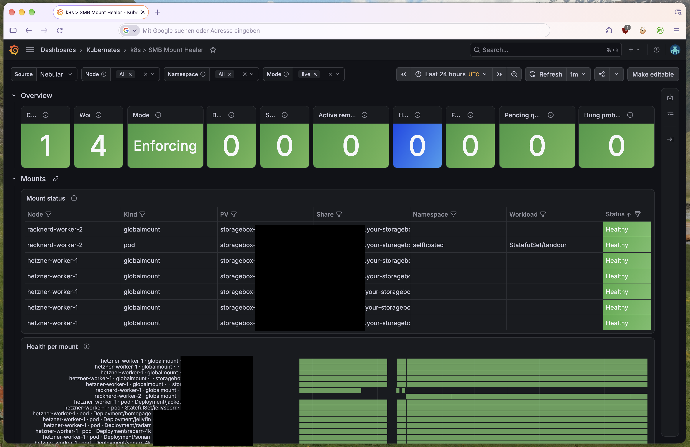

# smb-mount-healer

[](https://artifacthub.io/packages/search?repo=smb-mount-healer)
[](https://github.com/marcherschel/smb-mount-healer/releases/latest)
[](LICENSE)
[](go.mod)

A Kubernetes operator that detects broken SMB/CIFS volumes of
[csi-driver-smb](https://github.com/kubernetes-csi/csi-driver-smb) and heals
them, without losing the data your pods wrote while the mount was dead.

**Getting started:** the easiest way is the Helm chart on
[Artifact Hub](https://artifacthub.io/packages/helm/smb-mount-healer/smb-mount-healer),
which has the install command, all values and the custom resources. Then
follow the [quick start](#quick-start) below.


## Why

When an SMB server reboots, drops the session or changes its IP, the CIFS
mounts on your nodes can die **silently**. The pods stay `Running`, but their
volume:

- hangs or fails (`Host is down`, `stat` timeouts), or
- has quietly turned into the empty directory underneath the mount, so the
  app writes to the **node's local disk** instead of the share.

Kubernetes doesn't notice, and the kubelet doesn't re-stage a mount while pods
use it. Recovering means draining every pod of that volume on the node,
unmounting, restarting the CSI node driver, scaling back up, and then finding
whatever the app wrote to local disk in the meantime.

smb-mount-healer does all of that for you, one node at a time, and never
deletes data.

## How it works

```
 every node                                   cluster
┌──────────────────────────────┐   SmbMount   ┌─────────────────────────────────┐
│ worker (privileged DaemonSet)│ ───health──▶ │ control plane (Deployment,      │
│  probes every SMB mount      │              │ leader-elected)                 │
│  runs host tasks:            │ ◀─SmbHostTask│  opens an SmbMountRemediation   │
│   force-unmount, quarantine  │              │  per broken node and walks its  │
│  reports SmbQuarantines      │              │  state machine; scales workloads│
└──────────────────────────────┘              │  and restarts csi-smb-node      │
                                              └─────────────────────────────────┘
```

1. The **worker** on each node probes every SMB globalmount and pod mount
   (mount table, plus `stat`/`statfs` with a timeout in a child process, so
   a hung server can't block it). It publishes one `SmbMount` per node and
   PV, with rechecks to ride out short blips.
2. When a mount is `Broken`, the **control plane** creates an
   `SmbMountRemediation` for the node and works through it:
   1. Plan the scope: the broken pods' Deployments/StatefulSets, plus other
      workloads on the same share.
   2. Scale them to 0, then force-unmount the dead mounts.
   3. Move anything written to local disk into a quarantine folder.
   4. Restart the node's `csi-smb-node` pod, scale back up, and check that the
      new pods see a healthy mount.

   [docs/state-machine.md](docs/state-machine.md) specifies every stage.
3. Data that was rescued from local disk shows up as an `SmbQuarantine`, and
   the `SmbMountHealerShadowDataPending` alert fires until someone merges it
   back.

All state lives in custom resources, so you can follow every step with
`kubectl`. More in [docs/architecture.md](docs/architecture.md).

## Requirements

- Kubernetes ≥ 1.31 with Linux nodes.
- [csi-driver-smb](https://github.com/kubernetes-csi/csi-driver-smb). The
  defaults expect its node DaemonSet in `kube-system` with label
  `app=csi-smb-node`; set `csi.nodeDriver` otherwise.
- A namespace that allows privileged pods (Pod Security `privileged`). The
  worker has to unmount and move directories on the host.
- Workloads that use SMB volumes must be owned by a Deployment or
  StatefulSet, because the healer drains them by scaling. It never touches
  bare pods; it only reports them (outcome `skipped_no_owner`).

## Quick start

Using Flux? Follow the
[Flux quick start](production/smb-mount-healer/README.md#quick-start-with-flux)
instead: a namespace, an OCI `HelmRepository` and a `HelmRelease`, with notes
on non-default csi-driver-smb installs and kubelet paths.

With plain Helm: the chart is published at
`oci://ghcr.io/marcherschel/charts/smb-mount-healer` and listed on
[Artifact Hub](https://artifacthub.io/packages/helm/smb-mount-healer/smb-mount-healer).

Create the namespace and allow privileged pods in it:

```sh
kubectl create namespace smb-mount-healer-system
kubectl label namespace smb-mount-healer-system pod-security.kubernetes.io/enforce=privileged
```

Install in **dry-run mode** first. The healer then detects problems and plans
remediations, but doesn't scale, unmount or move anything:

```sh
helm install smb-mount-healer oci://ghcr.io/marcherschel/charts/smb-mount-healer \
  -n smb-mount-healer-system --set dryRun=true
```

Then watch what it sees and what it would do:

```sh
kubectl get smbmounts                # health of every SMB volume on every node
kubectl get smbr -o wide             # remediations; dry-run episodes end with OUTCOME dry_run
kubectl get smbt -o yaml             # the host actions it would have run
```

When you trust it, switch dry run off:

```sh
helm upgrade smb-mount-healer oci://ghcr.io/marcherschel/charts/smb-mount-healer \
  -n smb-mount-healer-system --reuse-values --set dryRun=false
```

All chart values are documented in the
[chart README](production/smb-mount-healer/README.md).

## Safety

- **Dry run.** `dryRun: true` walks every stage without acting. It also works
  as an emergency brake on a running installation.
- **Abort.** `kubectl annotate smbr <name> smbhealer.herschel.io/abort=true`
  rolls a running remediation back.
- **Rollback.** Deleting a remediation does the same: a finalizer restores
  every workload to its original replica count first.
- **Bounded.** One remediation per node and scope at a time. Exponential
  backoff (5m doubling to 1h) applies between episodes on the same mount, and
  every episode has a hard limit (30m) after which it rolls back.
- **Never deletes data.** Files written to a dead mount's local directory are
  moved to `<kubeletRoot>/smb-mount-healer-quarantine/` on the node. Recovery
  is in the
  [runbook](docs/runbooks/SmbMountHealerShadowDataPending.md).
- **Privacy.** Quarantine reports carry counts and sizes only. No file or
  directory name from user data appears in any CR, event, metric or log line.

## Monitoring

Both components export Prometheus metrics (`smb_mount_healer_*`). The chart
ships a Grafana dashboard and four alerts with runbooks.



The dashboard and the alerts are each behind an optional flag:

```yaml
metrics:
  podMonitor:
    enabled: true                          # needs the Prometheus Operator CRDs
    labels: {release: kube-prometheus-stack}
monitoring:
  grafanaDashboard:
    enabled: true                          # ConfigMap for the Grafana dashboard sidecar
  prometheusRule:
    enabled: true                          # PrometheusRule with the alerts below
    labels: {release: kube-prometheus-stack}
```

| Alert | Severity | Runbook |
|---|---|---|
| `SmbMountHealerControlPlaneAbsent` | critical | [runbook](docs/runbooks/SmbMountHealerControlPlaneAbsent.md) |
| `SmbMountHealerRemediationFailed` | warning | [runbook](docs/runbooks/SmbMountHealerRemediationFailed.md) |
| `SmbMountHealerRemediationLoop` | critical | [runbook](docs/runbooks/SmbMountHealerRemediationLoop.md) |
| `SmbMountHealerShadowDataPending` | warning | [runbook](docs/runbooks/SmbMountHealerShadowDataPending.md) |

Not using the Prometheus Operator? Every chart release (`chart-v*` on the
[releases page](https://github.com/marcherschel/smb-mount-healer/releases))
attaches the dashboard JSON, a plain Prometheus rule file and a rendered
PrometheusRule. Their sources are in [`monitoring/`](monitoring).

## Custom resources

All resources are in `smbhealer.herschel.io/v1alpha1` and are cluster-scoped.
`kubectl get smbhealer` lists all four kinds.

| Kind | Short | One per | Written by |
|---|---|---|---|
| `SmbMount` | `smbm` | node and PV | the worker (health) and the control plane (remediation status) |
| `SmbMountRemediation` | `smbr` | remediation episode | the control plane |
| `SmbHostTask` | `smbt` | batch of host actions | the control plane (spec) and the worker (results) |
| `SmbQuarantine` | `smbq` | quarantine folder on a node | the worker |

## Uninstall

```sh
helm uninstall smb-mount-healer -n smb-mount-healer-system
```

The CRDs and their objects are kept (`crds.keep: true`), and so is any
quarantined data on the nodes. To remove everything, delete the CRDs:

```sh
kubectl delete crd smbmounts.smbhealer.herschel.io smbmountremediations.smbhealer.herschel.io \
  smbhosttasks.smbhealer.herschel.io smbquarantines.smbhealer.herschel.io
```

## Documentation

- [Architecture](docs/architecture.md): run modes, custom resources, package layout, metrics
- [Remediation state machine](docs/state-machine.md)
- [Configuration](docs/configuration.md): flags and environment variables of the binary
- [Runbooks](docs/runbooks)
- [Development](docs/development.md) and [contributing](CONTRIBUTING.md)

## Status

The API is `v1alpha1` and releases are `0.x`, so fields may change between
minor versions. Every change is tested by unit tests, envtest,
a deterministic simulator, and an end-to-end suite that breaks real CIFS
mounts on a k3d cluster.

## License

GPL-2.0-only. See [LICENSE](LICENSE).
