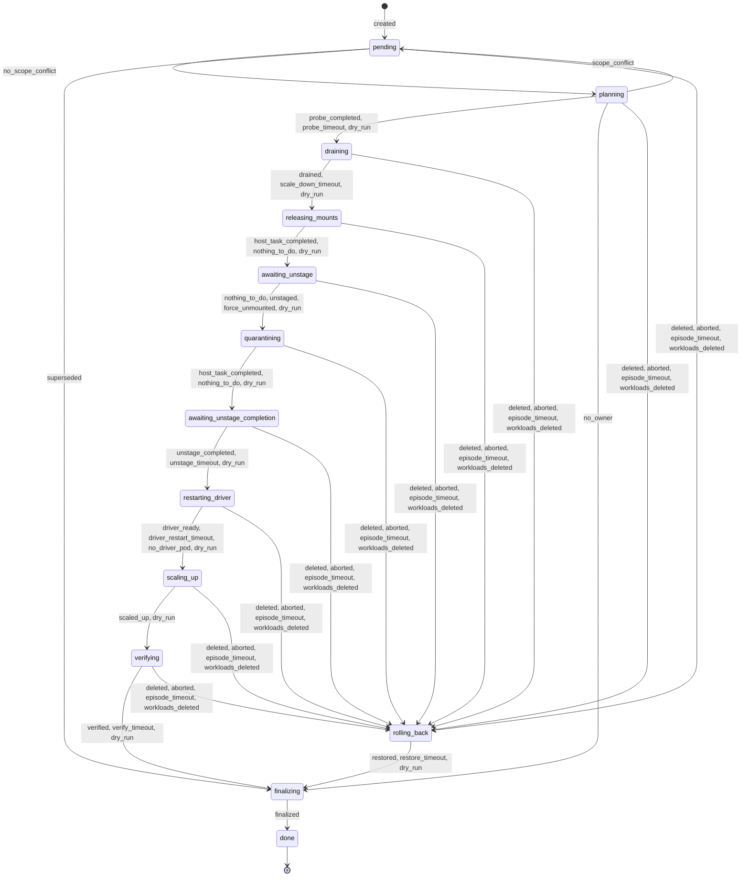
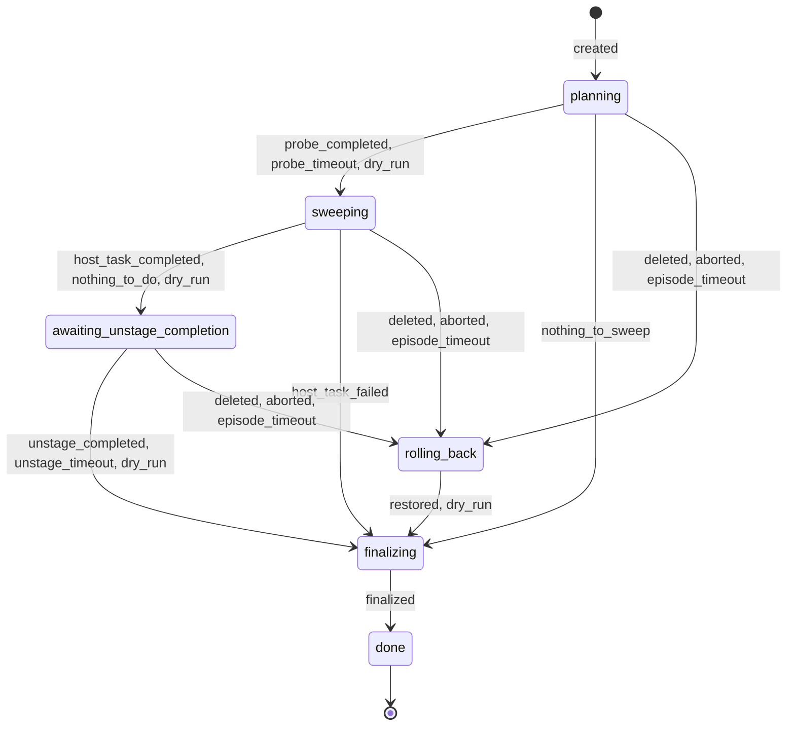

# Remediation state machines

<!-- Code generated from internal/remediation/table.go by
     "go generate ./internal/remediation"; DO NOT EDIT. -->

Every stage change of an `SmbMountRemediation` is one row of the tables
below; `remediation.Step` never produces any other transition (enforced by
the package tests). Wait guards poll every `POLL_INTERVAL` until their
deadline, which is an absolute timestamp in `status.deadline`. In dry run
every wait guard passes immediately, host tasks are created with
`dryRun: true` (only their existence is awaited), no workload is scaled and
no pod is deleted; the outcome is `dry_run`.

The control plane writes `Result.Status` before executing
`Result.Commands` (write-ahead); every command is idempotent.

## Workload

| From | To | Reasons | Guard | Actions |
|---|---|---|---|---|
| (new) | `pending` | `created` | first Step of a new object | set `startedTime` |
| `pending` | `planning` | `no_scope_conflict` | no other active remediation's scope contains a candidate workload | while conflicting: condition `ScopeConflict=True`, requeue `POLL_INTERVAL` |
| `pending` | `finalizing` | `superseded` | waited on a scope conflict, no broken pod of its own is left and every triggering `SmbMount` is Healthy again (outcome `healed`; a no-op that does not count towards backoff) | while it waited and has no broken pod yet: stay `pending` (the other remediation drained its pods; the replacements are planned once they break) |
| `planning` | `draining` | `probe_completed`, `probe_timeout`, `dry_run` | `ProbeNow` host task Succeeded/Failed, or `PLANNING_PROBE_WAIT`, or dry run | on entry: `CreateHostTask(ProbeNow)` for every globalmount of the node; scope (owners of broken pods + sibling PVs + co-tenants of non-healthy globalmounts) with `originalReplicas` from the live spec; on exit: re-plan with fresh health |
| `planning` | `finalizing` | `no_owner` | re-planned scope has no Deployment/StatefulSet (outcome `skipped_no_owner`) | – |
| `planning` | `pending` | `scope_conflict` | re-planned scope overlaps an older active remediation (tie-break: creation time, name) | clear scope |
| `draining` | `releasing_mounts` | `drained`, `scale_down_timeout`, `dry_run` | every drain pod gone and no pod on the node uses a co-tenant PV, or `SCALE_DOWN_WAIT` (Warning `DrainTimeout`), or dry run | `Scale(0)` (`scale_down`, then `scale_reassert` once observed at 0); add newly appearing owned co-tenant pods/workloads to scope |
| `releasing_mounts` | `awaiting_unstage` | `host_task_completed`, `nothing_to_do`, `dry_run` | host task Succeeded/Failed (failures are best effort), no mounted drain-pod path, or dry run (task exists) | `CreateHostTask(ForceUnmount pod paths of drain pods, onlyIf=NotHealthyMount)`; re-assert `Scale(0)` (`scale_reassert`) for any scoped workload above 0 replicas |
| `awaiting_unstage` | `quarantining` | `nothing_to_do`, `unstaged`, `force_unmounted`, `dry_run` | no dead globalmount, or all dead globalmounts unmounted, or after `UNSTAGE_WAIT` the force-unmount host task finished, or dry run (task exists) | on entry: record `deadGlobalmounts`; after `UNSTAGE_WAIT`: `CreateHostTask(ForceUnmount dead globalmounts)`; re-assert `Scale(0)` (`scale_reassert`) for any scoped workload above 0 replicas |
| `quarantining` | `awaiting_unstage_completion` | `host_task_completed`, `nothing_to_do`, `dry_run` | host task Succeeded/Failed, nothing to quarantine, or dry run (task exists) | `CreateHostTask` over pod dirs of any pod UID and the globalmount dir of every scoped PV: `ForceUnmount` (onlyIf=NotHealthyMount) + `Quarantine` (onlyIf=NotMountpoint); re-assert `Scale(0)` (`scale_reassert`) for any scoped workload above 0 replicas |
| `awaiting_unstage_completion` | `restarting_driver` | `unstage_completed`, `unstage_timeout`, `dry_run` | no scoped globalmount dir left unmounted, or `QUARANTINE_UNSTAGE_WAIT` (Warning `UnstagePinned` naming the pinning pods), or dry run | re-assert `Scale(0)` (`scale_reassert`) for any scoped workload above 0 replicas |
| `restarting_driver` | `scaling_up` | `driver_ready`, `driver_restart_timeout`, `no_driver_pod`, `dry_run` | a driver pod with a new UID is Running+Ready, or `DRIVER_RESTART_WAIT`, or no driver pod found, or dry run | record `driver.oldPod*` (written before the delete), then `DeletePod{uid}` (`driver_restart`) while the old pod exists; re-assert `Scale(0)` (`scale_reassert`) for any scoped workload above 0 replicas |
| `scaling_up` | `verifying` | `scaled_up`, `dry_run` | every existing scoped workload has replicas == originalReplicas, or dry run | `Scale(originalReplicas)` (`scale_up`) |
| `verifying` | `finalizing` | `verified`, `verify_timeout`, `dry_run` | every workload `verified` (new pods' podMounts Healthy) or `elsewhere` (no new pod after `VERIFY_NO_POD_GRACE`), or `VERIFY_WAIT` (rest `failed`), or dry run | `CreateHostTask(ProbeNow)` for scoped globalmounts, and once for the new pods' mount paths |
| any non-terminal | `rolling_back` | `deleted`, `aborted`, `episode_timeout`, `workloads_deleted` | deletionTimestamp set (finalizer), abort annotation, `EPISODE_MAX_DURATION` since start, or every scoped workload deleted (draining..verifying) | Warning `RollingBack`; condition `Aborted` on abort |
| `rolling_back` | `finalizing` | `restored`, `restore_timeout`, `dry_run` | every not-yet-restored workload back at originalReplicas (or deleted), or `SCALE_DOWN_WAIT` (Warning `RestoreTimeout`), or dry run (outcome `rolled_back`) | `Scale(originalReplicas)` (`rollback`) |
| `finalizing` | `done` | `finalized` | always | Event `RemediationFinished`; mirror `lastRemediation` + conditions onto affected `SmbMount`s |

## Sweep

| From | To | Reasons | Guard | Actions |
|---|---|---|---|---|
| (new) | `planning` | `created` | first Step of a new object | set `startedTime` |
| `planning` | `sweeping` | `probe_completed`, `probe_timeout`, `dry_run` | `ProbeNow` host task Succeeded/Failed, or `PLANNING_PROBE_WAIT`, or dry run; then orphan findings remain on unreferenced PVs | on entry: `CreateHostTask(ProbeNow)`; on exit: scope = triggering PVs with orphan findings and no pod on the node, `deadGlobalmounts` = their Broken mounted globalmounts |
| `planning` | `finalizing` | `nothing_to_sweep` | fresh health shows no orphan finding left (outcome `healed`) | – |
| `sweeping` | `awaiting_unstage_completion` | `host_task_completed`, `nothing_to_do`, `dry_run` | host task Succeeded, nothing to do, or dry run (task exists) | `CreateHostTask`: `ForceUnmount` dead orphan globalmounts and mounted orphan pod dirs (onlyIf=NotHealthyMount), `Quarantine` orphan pod dirs and globalmount dirs (onlyIf=NotMountpoint) |
| `sweeping` | `finalizing` | `host_task_failed` | host task Failed (outcome `failed`) | – |
| `awaiting_unstage_completion` | `finalizing` | `unstage_completed`, `unstage_timeout`, `dry_run` | no scoped globalmount dir left unmounted, or `QUARANTINE_UNSTAGE_WAIT` (Warning `UnstagePinned`), or dry run (outcome `healed` / `dry_run`) | – |
| `planning`, `sweeping`, `awaiting_unstage_completion` | `rolling_back` | `deleted`, `aborted`, `episode_timeout` | deletionTimestamp set, abort annotation, or `EPISODE_MAX_DURATION` | Warning `RollingBack` |
| `rolling_back` | `finalizing` | `restored`, `dry_run` | nothing to restore (outcome `rolled_back`) | – |
| `finalizing` | `done` | `finalized` | always | Event `RemediationFinished`; mirror stage onto affected `SmbMount`s |

